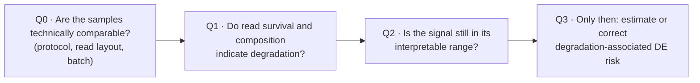

# RNA degradation and false differential expression

> **Question:** can unequal RNA degradation between groups create or inflate differential expression when the biological difference is absent or smaller? And can the read statistics that every paired-end pipeline already produces warn that a comparison is at risk?
>
> *Status: manuscript in preparation; a reproducible pipeline is being built.*

## Why it matters

Public RNA-seq is reused at scale, and a RIN value says little about what happened to a sample after it was measured. If degradation differs between groups, part of a DE list is technical, and it is reproducible enough to look like biology.

## Approach

- **Ground truth first.** Simulations from count level up to full read level (simulated reads → trimming → STAR → featureCounts → DESeq2), where every false positive is known.
- **Real data second.** Controlled degradation series and boundary tests in human, mouse, grapevine, *Arabidopsis*, *Brassica* and *E. coli*, plus a Nanopore direct-RNA series as a cross-platform check.
- **Cheap signals only.** Paired-read survival after trimming and rRNA composition, without coverage modelling.

## Headline results so far

- With **zero true DE** simulated, unequal degradation roughly doubled the false-positive rate, and the false calls leaned toward apparent down-regulation.
- **How** degradation happens matters: compounding degradation produced more false DE than a single event with the same final severity.
- A naive QC predictor trained on mild-to-moderate damage **failed in the wrong direction** on unseen severe damage: singleton-read counts first rise, then fall as molecules are lost. Adding the total surviving read pool as a denominator removes the ambiguity.
- In a public human brain degradation series (same donors, so every DE call is false), two read-level covariates cut false-positive DE calls from **9,989 to 172**.
- The degradation–error relationship is **saturating, not linear**, both in simulations and in an independent Nanopore direct-RNA series.

## From finding to tool: gates, not a single score

Q0 comes first for a measured reason. Applied across a real batch boundary, a risk slope calibrated within one experiment predicted 83 DE genes where 10,320 were found, and 21,162 where 8 were found.

**Positioning.** TIN, qSVA and DegNorm model read coverage along transcripts. This layer uses signals that already exist after routine processing, and it is built to say when *not* to trust them.

**Next:** a Nextflow pipeline (paired FASTQs in, QC gates and DESeq2-ready covariates out) and a pre-registered test, without tuning, on a 325-sample clinical glioma cohort.
